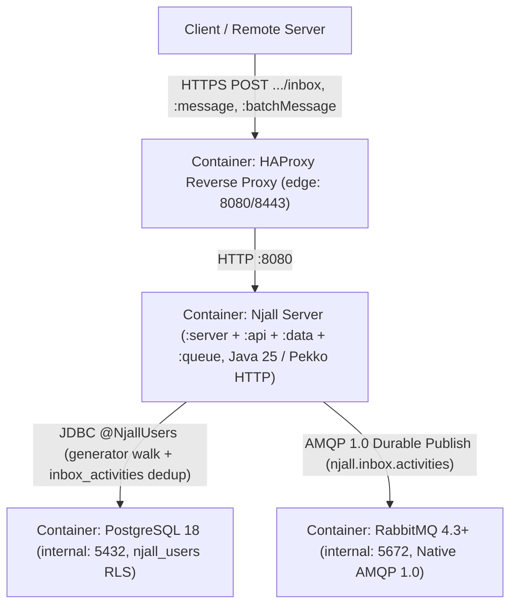
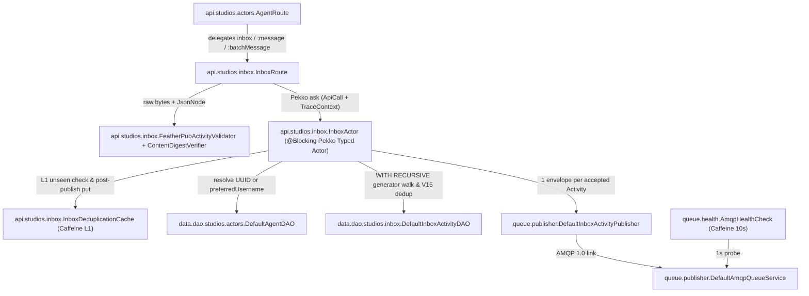

## Context

**Njall** implements multi-single-tenant federation across **Studios** following the **FeatherPub**
protocol (`docs/FEATHERPUB.md`) and the currently in-force architectural decision set:
- [0001: Pekko HTTP Runtime Architecture and Multimodule Layout](../../../../adr/0001-pekko-http-runtime-architecture.md)
- [0002: Dropwizard HealthCheck and Pekko Typed Health Actor Pattern](../../../../adr/0002-dropwizard-healthcheck-actor-pattern.md)
- [0005: Sealed DAO and Hibernate Dual Session Architecture](../../../../adr/0005-sealed-dao-and-hibernate-dual-session-architecture.md)
- [0007: Docker Compose Multi-Container Orchestration and Staged Packaging](../../../../adr/0007-docker-compose-and-container-orchestration.md)
- [0008: Module-Level Singleton Scoping Convention](../../../../adr/0008-module-level-singleton-scoping-convention.md)
- [0009: Hibernate SessionFactory Provider Injection and ArchUnit Enforcement](../../../../adr/0009-hibernate-session-factory-provider-injection-and-archunit-enforcement.md)
- [0011: ArchUnit Injected Constructor Visibility and Package Dependency Rules](../../../../adr/0011-archunit-injected-constructor-visibility-and-package-dependency-rules.md)
- [0015: Docker Compose Secret Derivation and Local Environment Isolation](../../../../adr/0015-docker-compose-secret-derivation-and-isolation.md)
- [0017: OpenTelemetry SDK and Logback MDC Tracing Architecture](../../../../adr/0017-opentelemetry-sdk-and-logback-mdc-tracing-architecture.md)
- [0018: Caffeine-Cached Administrative Database Health Check](../../../../adr/0018-caffeine-cached-database-health-check.md)
- [0021: ArchUnit Record Factory Prohibition and Pure Data Carriers](../../../../adr/0021-archunit-record-factory-prohibition-and-pure-data-carriers.md)
- [0022: ArchUnit Immutable Records and ErrorProne Enforcement](../../../../adr/0022-archunit-immutable-records-and-errorprone-enforcement.md)
- [0023: Record Component Non-Null Invariant and Boundary Normalization](../../../../adr/0023-record-component-nonnull-invariant-and-boundary-normalization.md)
- [0024: HAProxy Ingress Reverse Proxy and Network Segmentation](../../../../adr/0024-haproxy-ingress-reverse-proxy-and-network-segmentation.md)
- [0025: User Space Studios API and Tenant Row-Level Security](../../../../adr/0025-user-space-studios-api-and-tenant-row-level-security.md)
- [0026: Caffeine Cached Studio Lookup Service](../../../../adr/0026-caffeine-cached-studio-lookup-service.md)
- [0030: DAO Naming Conventions and Entity Immutability Standards](../../../../adr/0030-dao-naming-conventions-and-entity-immutability-standards.md)
- [0032: Package Size Limits and Subpackage Decomposition](../../../../adr/0032-package-size-limits-and-subpackage-decomposition.md)
- [0038: Tenanted Actors and Federated Endpoints Architecture](../../../../adr/0038-tenanted-actors-and-federated-endpoints-architecture.md)
- [0040: Actor-Parented Collections Routes and Entity Generator Column](../../../../adr/0040-actor-parented-collections-and-entity-generator-column.md)
- [0041: Tenanted Systems, Campaigns, and Games Two-Level CTI and Domain Decomposition Architecture](../../../../adr/0041-tenanted-systems-campaigns-and-games-architecture.md)

Today, `AgentRoute` and `AgentActor` implement a temporary `POST .../actors/{actor-id}/inbox` stub
that accepts any JSON object, ignores it, and returns `201 Created`. Moreover,
`gradle/libs.versions.toml` currently declares `com.rabbitmq:amqp-client:5.37.1` (the legacy AMQP
0-9-1 driver) rather than an AMQP 1.0 client, and `docker-compose.yml` does not yet run a RabbitMQ
broker. Transitioning from the stub to the **FeatherPub** API-to-Queue ingress boundary must solve
five concrete constraints:
1. **Strict AMQP 1.0 Broker & Client**: Project standards mandate AMQP 1.0 against RabbitMQ 4.3+
   isolated inside a dedicated `:queue` **Library module** with coordinated lifecycle startup and
   health checking.
2. **Canonical Actor Addressing & Generator Routing**: **FeatherPub** **Actor** URIs address actors
   by UUID or `preferredUsername`, and any **Actor** receiving an **Activity** must route messages
   addressed to itself or any descendant **Actor** it transitively generated
   (`njall_users.entities.generator`).
3. **Union-Free Activity & AIP-233 Partial-Success Batching**: Single deliveries (`inbox` and
   `inbox:message`) validate a discriminated 10-verb **FeatherPub** **Activity**, while
   `inbox:batchMessage` accepts a plain AIP-233 `{ "requests": [ ... ] }` wrapper and allows valid
   items to succeed even when sibling items fail.
4. **Crash-Safe Eight-Day Idempotency**: Senders retry deliveries for up to 7 days (`docs/FEATHERPUB.md`),
   requiring an 8-day deduplication store in PostgreSQL fronted by Caffeine that survives **Server**
   restarts without blackholing retries when broker publication fails.
5. **ArchUnit Package Capacity**: Both `com.larpconnect.njall.api.studios.actors` and
   `com.larpconnect.njall.data.domain.studios` (17/20 types) sit near the 20-type ceiling enforced
   by `ADR-0032`, requiring dedicated `inbox` subpackages in `:api` and `:data`.

## Goals / Non-Goals

**Goals:**
- Introduce the `:queue` **Library module** (`com.larpconnect.njall.queue`) using RabbitMQ's
  official AMQP 1.0 client (`com.rabbitmq.client:amqp-client:1.7.0`), `AmqpQueueService`,
  `InboxActivityPublisher`, and Caffeine-cached `AmqpHealthCheck`.
- Provision `rabbitmq:4.3-alpine` (native AMQP 1.0 on `internal:5672` with `NJALL_DB_SECRET`
  credential derivation) in `docker-compose.yml`.
- Expose `POST .../inbox`, `POST .../inbox:message`, and AIP-233 partial-success
  `POST .../inbox:batchMessage` returning `202 Accepted`, resolving `{actor-id}` by UUID or
  case-insensitive `preferredUsername` (also supported on `GET .../actors/{actor-id}` and
  `GET .../inbox`).
- Validate `Content-Digest` (`sha-256`, `sha3-256`), the union-free 10-verb **FeatherPub**
  **Activity** schema, authority host matching, temporal bounds, pre-queue **generator**-hierarchy
  recipient routing, and 8-day Caffeine + PostgreSQL (`V15__inbox_activity_deduplication.sql`)
  idempotency.
- Verify the API-to-Queue boundary end-to-end in `:integration` using Cucumber, Testcontainers
  PostgreSQL 18+, and Testcontainers RabbitMQ 4.3+.

**Non-Goals:**
- Server-to-server `Authorization: Bearer <at+jwt>` EdDSA signature verification, remote JWKS
  fetching, `.well-known/jwks.json`, SSRF IP blocklisting, and inbound rate limiting (deferred to a
  dedicated federation security change).
- Provisioning studio-level `default` **Actor** records on studio creation (deferred; routing works
  generally across all **Actor** **generator** hierarchies).
- Downstream queue consumer workers that mutate CTI **Entity** tables, **Collections**, or timeline
  views (Stage 4 Queue-to-Data boundary, deferred to the consumer change).
- Standing up Memcached in `docker-compose.yml` (in-memory Caffeine L1 + PostgreSQL persistence
  satisfies initial single-node latency and durability requirements).

## Architectural Diagrams (Lightweight C4-Inspired)

### Container View (Ingress, Persistence, and AMQP 1.0 Broker)

### Component View (Inside Njall Server Container)

- **Boundaries**: `haproxy` and `server` share `edge`, while `postgres` and `rabbitmq` reside
  strictly on `internal` with zero host port exposure. Inside the JVM, `:api` depends on `:data` and
  `:queue` (sibling **Library module** dependencies), `:queue` depends only on `:common` and AMQP
  libraries, and `:server` composes `ApiModule`, `DataModule`, and `QueueModule`.
- **Responsibilities**: `InboxRoute` extracts raw request bytes (for `Content-Digest` verification)
  and JSON payloads before asking `InboxActor`; `InboxActor` coordinates recipient resolution,
  Caffeine/PostgreSQL deduplication, and `InboxActivityPublisher` confirmation before persisting
  deduplication keys.
- **Key Relationships**: Every package dependency flows downward or outward (`api.studios.actors` ->
  `api.studios.inbox` -> `{data.dao.studios.inbox, queue.publisher}` -> `data.domain.inbox` ->
  `data.domain.common`), maintaining a strict DAG with <= 20 counted types per package.
- **Assumptions**: RabbitMQ 4.3+ enables AMQP 1.0 natively in core on port `5672` without extra
  plugins; `njall.inbox.activities` serves as the durable ingress queue consumed by future Stage 4
  workers.
- **Open Questions**: None blocking implementation; in-force ADRs `0001`, `0007`, `0032`, `0038`,
  and `0041` are flagged below for formal amendment in `adr/0042-*.md`.

## Decisions

### 1. Dedicated `:queue` Module and Official RabbitMQ AMQP 1.0 Client
- **Choice**: Create the `:queue` Gradle **Library module** (`com.larpconnect.njall.queue` with
  subpackages `config`, `publisher`, and `health`) and replace `com.rabbitmq:amqp-client:5.37.1` in
  `gradle/libs.versions.toml` with `com.rabbitmq.client:amqp-client:1.7.0`. Manage the AMQP 1.0
  `Environment`, `Connection`, management queue declaration (`njall.inbox.activities`), and durable
  `Publisher` inside `DefaultAmqpQueueService` (implementing Guava `Service`, started before HTTP
  socket binding in `DefaultServerManagerService`), and expose a 10-second Caffeine-cached
  `AmqpHealthCheck` mirroring `AdminDatabaseHealthCheck` (`ADR-0018`). Stand up `rabbitmq:4.3-alpine`
  in `docker-compose.yml` on `internal` with credentials `njall_amqp_${NJALL_DB_SECRET}`.
- **Rationale**: `com.rabbitmq:amqp-client` speaks legacy AMQP 0-9-1, violating the repository
  mandate for AMQP 1.0. RabbitMQ's `com.rabbitmq.client:amqp-client` (`1.7.0`) is purpose-built for
  RabbitMQ 4.x native AMQP 1.0, provides explicit broker disposition callbacks (`Publisher.Status.ACCEPTED`),
  and avoids pulling Jakarta JMS or Netty dependency trees required by Qpid Proton-J2. Isolating
  broker code in `:queue` mirrors `:data` and keeps `:common` lightweight.
- **Alternatives Considered**:
  - Keeping `com.rabbitmq:amqp-client` `5.x`. Rejected because it speaks AMQP 0-9-1 rather than
    AMQP 1.0.
  - Apache Qpid Proton-J2 or Pekko Connectors AMQP. Rejected because Pekko Connectors AMQP wraps
    AMQP 0-9-1, while raw Proton-J2 requires custom SASL/link-credit recovery boilerplate already
    solved in `com.rabbitmq.client:amqp-client`.

### 2. Subordinate `InboxRoute` Package and `{actor-id}` UUID-or-`preferredUsername` Resolution
- **Choice**: Place inbox HTTP routes, Pekko **Actor**, validators, and **DTO** records in
  `com.larpconnect.njall.api.studios.inbox` (`InboxModule`), delegated from `AgentRoute` for
  `inbox` (`POST`), `inbox:message` (`POST`), and `inbox:batchMessage` (`POST`). Extend `AgentDAO`
  with `findByPreferredUsername` and `findByIdentifier` (UUID parse fast-path, then case-insensitive
  `lower(preferred_username)` lookup on active `'Actor'` rows) and accept `{actor-id}` by UUID or
  `preferredUsername` on `GET /actors/{actor-id}`, `GET /actors/{actor-id}/inbox`, and all three
  `POST` inbox endpoints.
- **Rationale**: `com.larpconnect.njall.api.studios.actors` is near the 20-type `ADR-0032` ceiling
  and `AgentRoute` is already 420 SLOC (`AGENTS.md` caps classes at 500 SLOC). Delegating to
  `InboxRoute` mirrors `CollectionsRoute` (`ADR-0040`), keeps `AgentRoute` compact, and performs
  non-UUID `preferredUsername` lookups asynchronously inside Pekko actors rather than blocking the
  HTTP routing dispatcher.
- **Alternatives Considered**:
  - Adding inbox classes directly to `api.studios.actors`. Rejected because it breaches the 20-type
    package limit and 500-SLOC class limit.
  - Resolving `preferredUsername` synchronously inside `AgentRoute.handleActorBranch`. Rejected
    because JDBC calls on the Pekko HTTP dispatcher starve non-blocking routing threads.

### 3. Pre-Queue Generator-Hierarchy Routing via Recursive Ancestor Walk
- **Choice**: Extract local **Studio** candidate **Actor** identifiers from the union of `to` and
  `cc` on the **Activity** (and on an embedded `object` when present), matching relative or absolute
  URIs of the form `/api/studios/{studio-uuid-or-alias}/v1/actors/{uuid-or-preferredUsername}` for
  the target **Studio**. Resolve candidates and verify lineage in `DefaultInboxActivityDAO` using a
  single `@NjallUsers` `WITH RECURSIVE` SQL query that starts at the candidate active `'Actor'` rows
  and walks **up** `njall_users.entities.generator` (halting on `generator = id` self-roots or a
  safety depth cap of 64, requiring `deleted_on IS NULL` at every hop) to confirm `receivingActorId`
  is an ancestor (or self). Publish one durable AMQP 1.0 message per accepted **Activity** carrying
  the resolved `targetActorIds` list.
- **Rationale**: Walking upward from the small set of addressed local recipients (`O(k * depth)`
  primary-key lookups) avoids scanning an arbitrary fan-out of thousands of generated child entities
  under a prolific **Actor**. Pre-queue routing rejects misaddressed deliveries synchronously with
  `400 Bad Request` before consuming broker storage.
- **Alternatives Considered**:
  - Expanding the entire downward subtree of `{actor-id}` on every request. Rejected because popular
    generator actors can own large entity trees whereas `to`/`cc` candidate counts are bounded.
  - Deferring recipient routing until after AMQP queuing. Rejected because HTTP ingress could not
    synchronously report `400 Bad Request` (or per-index `failedRequests` in `:batchMessage`) for
    unroutable deliveries.

### 4. Union-Free Activity Validation and AIP-233 Partial-Success `:batchMessage`
- **Choice**: Parse inbound JSON via Jackson `JsonNode` at the boundary (`Content-Digest` verified
  first against raw `ByteString` bytes using `MessageDigest` `SHA-256` / `SHA3-256` when the header
  is present) into validated `@Immutable` records enforcing strict array types (`@context`, `to`,
  `cc`, `audience`, `mixins`), authority host matching (`id` host equals or subdomains `actor` host
  when absolute), 5-minute future skew / 8-day past window on `created`, and 10-verb structural
  rules. For `POST .../inbox:batchMessage`, accept `{ "requests": [ <JsonNode>, ... ] }` (1..100
  items, no outer `@context`) and evaluate items sequentially in `InboxActor`: return `202 Accepted`
  with `{ "failedRequests": { "<idx>": { "code": ..., "message": "..." } } }` when >= 1 item is
  accepted, or `400 Bad Request` (or `503` if all failures are broker outages) with
  `BatchInboxErrorResponse` (`code`, `message`, `failedRequests`) when 0 items succeed.
- **Rationale**: Parsing `requests` as `List<JsonNode>` ensures a syntactically invalid **Activity**
  at index `i` produces a clean `"i"` entry in `failedRequests` instead of failing Jackson
  deserialization for the entire HTTP batch, directly implementing Google AIP-233 partial-failure
  guidance.
- **Alternatives Considered**:
  - Atomic all-or-nothing batch rejection. Rejected per user direction and AIP-233 guidance for
    non-atomic federated delivery queues.
  - Wrapping `:batchMessage` in a **FeatherPub** `Collection` object. Rejected per user direction
    because `:batchMessage` is an AIP-233 RPC transport envelope rather than a federated entity.

### 5. Post-Publish Eight-Day Deduplication Across Caffeine L1 and PostgreSQL (`V15`)
- **Choice**: Create `njall_users.inbox_activities` (`V15__inbox_activity_deduplication.sql`) keyed
  by `(tenant_id, target_actor_id, activity_id)` with `received_on`, `expires_on` (`received_on + 8
  days`), `ON DELETE CASCADE` to `njall_users.actors`, `idx_inbox_activities_expires`, and RLS
  policy `rls_inbox_activities`. Front lookups with a bounded Caffeine cache (`maximumSize = 50_000`,
  `expireAfterWrite` bounded by retention) keyed by `(tenantId, targetActorId, activityId)`. Check
  Caffeine first and PostgreSQL on L1 misses to filter `targetActorIds` down to unseen targets; if
  all targets were already seen, return `202 Accepted` immediately without publishing. Otherwise,
  publish to AMQP 1.0, await `Publisher.Status.ACCEPTED`, and only then insert rows into
  `njall_users.inbox_activities` and populate Caffeine.
- **Rationale**: Recording deduplication state strictly after broker `ACCEPTED` confirmation ensures
  a transient RabbitMQ outage returns `503 Service Unavailable` so remote senders retry cleanly,
  whereas a brief crash between broker publish and DB insert at worst yields an idempotent redelivery
  to downstream Stage 4 consumers. Dedicated `data.domain.inbox` and `data.dao.studios.inbox`
  packages keep `data.domain.studios` at 17/20 types.
- **Alternatives Considered**:
  - In-memory-only Caffeine deduplication. Rejected because **Server** restarts within the 7-day
    sender retry window would lose all deduplication state.
  - Recording PostgreSQL deduplication rows before AMQP publish without broker rollback. Rejected
    because a failed AMQP publish would permanently drop subsequent retries as "duplicates."

## Risks / Trade-offs

- **[Risk]** Crash in the narrow window after RabbitMQ confirms `ACCEPTED` but before PostgreSQL
  commits `njall_users.inbox_activities` allows a sender retry to publish a second AMQP message ->
  **Mitigation**: Downstream Stage 4 queue consumers will execute idempotent upserts/tombstones
  keyed by **Entity** and **Activity** IDs (`messageId = activity.id`), making rare at-least-once
  redelivery safe while guaranteeing zero silent message loss.
- **[Risk]** Cyclic `generator` data (if ever introduced bypassing application checks) could stall a
  naive recursive CTE -> **Mitigation**: Terminate the `WITH RECURSIVE` walk whenever
  `generator = id`, `depth >= 64`, or a visited `id` repeats (`NOT id = ANY(visited)` cycle guard).
- **[Risk]** Unbounded growth of expired rows in `njall_users.inbox_activities` -> **Mitigation**:
  Index `(tenant_id, expires_on)` (`idx_inbox_activities_expires`) and opportunistically prune
  expired rows for target actors during write transactions, keeping table size proportional to active
  8-day traffic.
- **[Risk]** Adding `rabbitmq` to `docker-compose.yml` increases container startup time and memory
  footprint -> **Mitigation**: Use lightweight `rabbitmq:4.3-alpine` on `internal` with fast
  `rabbitmq-diagnostics -q check_port_connectivity` health polling in parallel with `postgres`/`migrate`.

## Migration Plan

1. **Dependencies & `:queue` Module**: Swap `rabbitmq-amqp` in `gradle/libs.versions.toml` and
   `parent/build.gradle.kts` to `com.rabbitmq.client:amqp-client:1.7.0`, register `:queue` in
   `settings.gradle.kts` and `bom/build.gradle.kts`, and add `njall.queue` defaults to
   `common/src/main/resources/reference.conf`.
2. **Database Schema (`V15`) & `:data` Persistence**: Apply additive Flyway migration
   `V15__inbox_activity_deduplication.sql`, extend `AgentDAO` with `preferredUsername` lookup, and
   implement `data.domain.inbox` + `data.dao.studios.inbox` (`InboxActivityDAO`).
3. **API & Server Wiring (`:api`, `:server`)**: Update `openapi.yaml` (**BREAKING** `201 -> 202` on
   `POST .../inbox`, plus `:message` and `:batchMessage`), implement `api.studios.inbox`, delegate
   from `AgentRoute`, install `QueueModule` in `ServerModule`, and start/stop `AmqpQueueService` in
   `DefaultServerManagerService`.
4. **Docker Compose & Rollback**: Add `rabbitmq:4.3-alpine` and `NJALL_QUEUE_*` environment wiring
   to `docker-compose.yml`. Rollback in pre-production drops `njall_users.inbox_activities` and
   reverts the `rabbitmq` compose service without affecting existing CTI entity tables.

## Open Questions

- None blocking implementation. In the `adr` step immediately following this design, a new durable
  ADR (`adr/0042-featherpub-inbox-ingress-and-amqp-queue-architecture.md`) will record these
  commitments and formally amend in-force ADRs `0001` (adding `:queue` to the multimodule layout),
  `0007` (adding `rabbitmq` to Docker Compose orchestration), `0032` and `0041` (adding
  `api.studios.inbox`, `data.dao.studios.inbox`, and `data.domain.inbox` subpackages), and `0038`
  (replacing the `201 Created` `POST .../inbox` stub with `202 Accepted` **FeatherPub** **Activity**
  ingress and supporting case-insensitive `preferredUsername` resolution).
